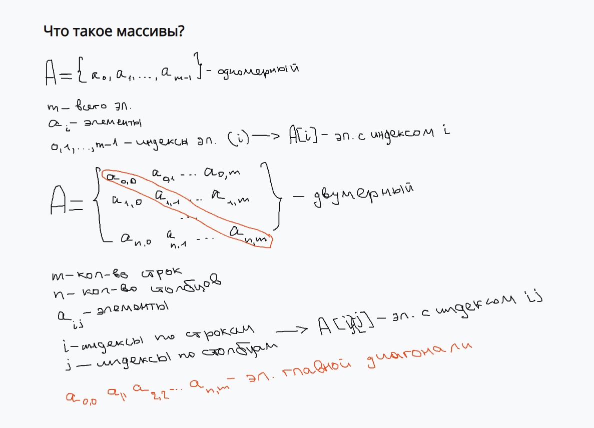
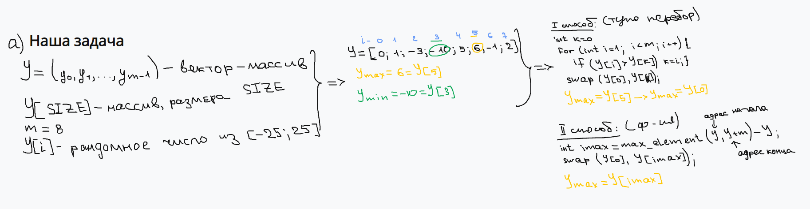
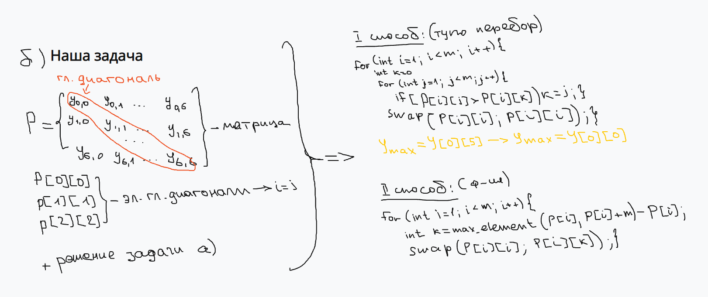

# 🚀 С++ ЛАБОРАТОРНАЯ РАБОТА 5

Цели и задачи: изучить основные понятия о массивах и методы работы с ними.<br>
#### Вариант №11:
<ul>
  а) В векторе У[m] поменять местами максимальный с первым и минимальный с последним элементы.<br>
  б) Задана матрица P[7][7]. Найти в каждой строке наибольший элемент и поменять его местами с элементами главной диагонали.
</ul>

## ✨ Теория




## 📦 Быстрый старт
### Требования
Знать теоретический минимум.<br>
Иметь примерное представление о решении.<br>
У вас должна быть установлена любая IDE для работы с С++: [VS Code](https://code.visualstudio.com/), [Clion](https://www.jetbrains.com/de-de/clion/), [DEV C++](https://www.embarcadero.com/free-tools/dev-cpp).<br>
У вас должен быть установлен [компилятор g++](https://www.msys2.org/).<br>
У вас должен быть установлен [Git](https://git-scm.com/).
### Установка
1. Проверить, что всё установлено (в терминале):
  ```bash
  git --version
  g++ --version
  ```

Если обе команды показали версию, можно продолжать.

2. Клонирование репозитория
  ```bash
  git clone https://github.com/0va1ski/isit.git
  cd isit/laba5
  ```

Первая команда скачивает репозиторий в папку `isit`, вторая переходит в папку лабораторной работы.<br>
Чтобы позже получить свежие изменения, выполните внутри папки репозитория:
  ```bash
  git pull
  ```

3. Компиляция
Программы нужно **собрать**, готовых `.exe` в репозитории нет. Формат команды:
  ```bash
  g++ -std=c++17 исходный_файл.cpp -o имя_программы
  ```

Пример для задания a:
  ```bash
  cd a
  g++ -std=c++17 a1.cpp -o a1
  ```

Для задания b:
  ```bash
  cd ../b
  g++ -std=c++17 b1.cpp -o b1
  ```

Если компиляция прошла успешно, команда ничего не выведет, а рядом появится готовый файл
(`a1.exe` на Windows, `a1` на Linux и macOS). Если появились сообщения об ошибках, программа не собралась.

4. Запуск
Windows (PowerShell):
  ```powershell
  .\a1
  ```

Linux / macOS:
  ```bash
  ./a1
  ```

5. Примеры

| Задание | Исходник | Команда сборки | Запуск |
|---|---|---|---|
| a, способ 1 | `a/a1.cpp` | `g++ -std=c++17 a1.cpp -o a1` | `.\a1` |
| a, способ 2 | `a/a2.cpp` | `g++ -std=c++17 a2.cpp -o a2` | `.\a2` |
| b, способ 1 | `b/b1.cpp` | `g++ -std=c++17 b1.cpp -o b1` | `.\b1` |
| b, способ 2 | `b/b2.cpp` | `g++ -std=c++17 b2.cpp -o b2` | `.\b2` |

6. Если что-то не работает

| Проблема | Что делать |
|---|---|
| `g++` не распознана | Компилятор не установлен или не добавлен в `Path`. После установки перезапустите терминал |
| `No such file or directory` | Вы не в той папке. Проверьте `dir` (Windows) или `ls` (Linux) |
| Запускается старая версия | После правки кода программу нужно собрать заново |
| Ошибка при компиляции | Прочитайте первую строку с `error`, в ней указана строка кода с проблемой |
| Кракозябры вместо русского текста | Перед запуском выполните `chcp 65001` |

Онлайн-вариант<br>
Если компилятор ставить не хочется, откройте любой `.cpp` файл, скопируйте код в [онлайн-компилятор](https://www.onlinegdb.com/online_c++_compiler) и нажмите **Run**.
